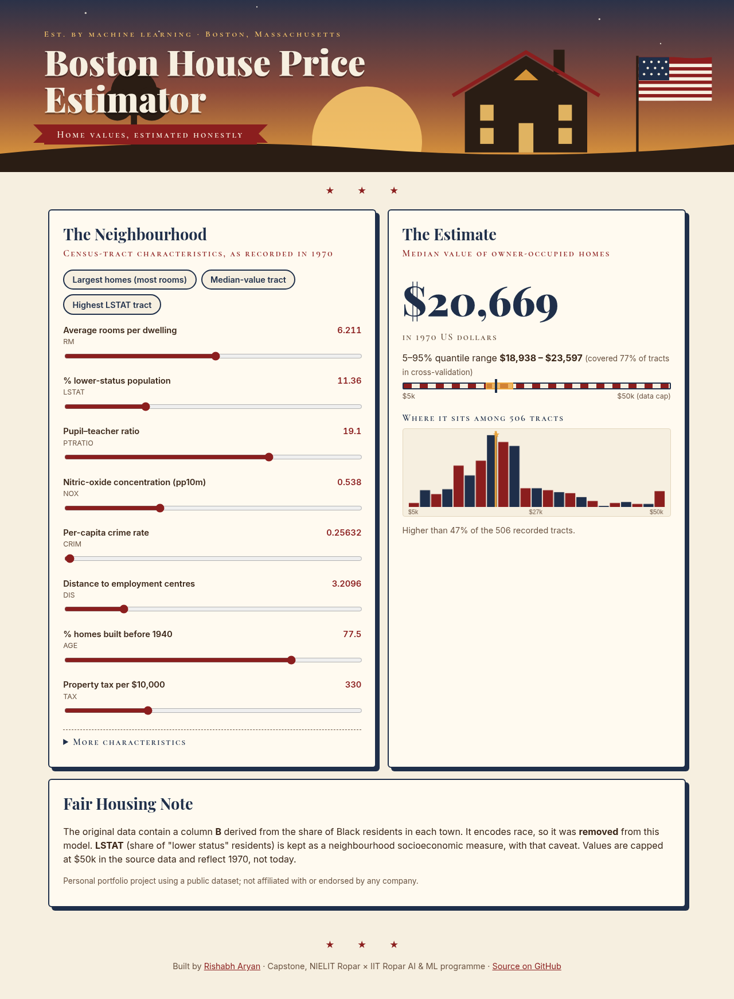
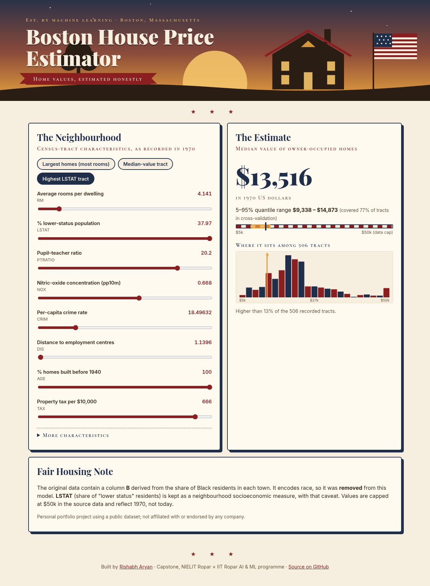
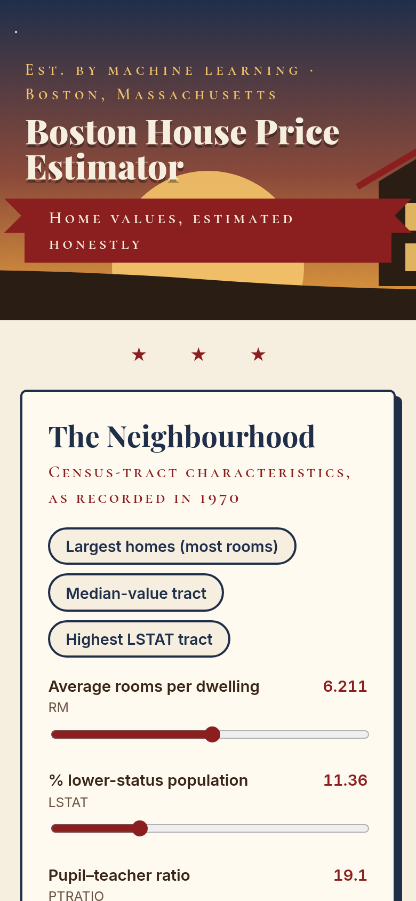
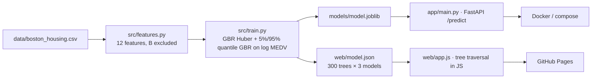

<div align="center">

# 🏡 Boston House Price Prediction — Machine Learning Regression in Python (scikit-learn, FastAPI) with a Live In-Browser App

[](https://rishabh-bgp.github.io/boston-house-price-prediction/)
[](https://github.com/Rishabh-bgp/boston-house-price-prediction/actions/workflows/ci.yml)


**[▶ Open the live app](https://rishabh-bgp.github.io/boston-house-price-prediction/)**



</div>

An end-to-end **machine learning regression project** that predicts the **median home value of Boston census tracts**
from the classic **Boston housing dataset**: EDA, **repeated K-fold cross-validation** of linear, ridge, random-forest
and gradient-boosting models, **log-target** and outlier-robust (**Huber**) training, censoring and fairness checks,
**permutation importance**, quantile prediction ranges, a **FastAPI** REST API, **Docker**, **pytest**, **GitHub Actions
CI** and a web app on **GitHub Pages** where the gradient-boosted trees run in your browser.

## 🎓 About this project
Developed as part of my training with **KF Property Network Pte Ltd (KFPN)**, a real estate agency associate business in
Singapore operating as a subsidiary of Knight Frank Singapore — a machine learning model for Boston, USA — and submitted as
my capstone for the **6-Month Joint Certification Program in AI & ML by [NIELIT Ropar](https://www.nielit.gov.in/ropar/)
with [IIT Ropar](https://www.iitrpr.ac.in/)**:

* Live, interactive sessions with NIELIT faculty
* Expert guest lectures from IIT Ropar professors on Natural Language Processing, Deep Learning and Neural Networks
* Hands-on lab access and project-based teaching
* A campus immersion visit to IIT Ropar

> **Disclaimer:** this is a personal portfolio project using a public dataset. It is not an official product of, and is
> not endorsed by, KFPN, Knight Frank or any other company, and it is not a property valuation service.

## ⚖️ Ethics: why `B` is excluded, and other known issues
* **`B` encodes race.** It is defined as 1000(Bk − 0.63)², where Bk is the proportion of Black residents by town. Using it
  would make predictions depend on a neighbourhood's racial make-up, so it is **removed from the deployed model, the API
  and the web app**. The notebook measures what that costs (section 3b): RMSE **3.157** without B vs **3.130** with it —
  within fold-to-fold noise.
* **`LSTAT`** (% "lower status" population) is kept: it is the strongest predictor and a neighbourhood socioeconomic
  measure, but it is a proxy that can carry historical inequality, and its definition is dated. Read its effect as a
  description of 1970 data, not a judgement about people.
* **Censoring:** `MEDV` is capped at 50 ($50,000) for 16 tracts, so the highest values are unknown.
* **Age of the data:** 1970 census tracts; values are in 1970 dollars and do not describe today's market.
* The dataset was removed from scikit-learn's built-in loaders because of these issues; it is used here for teaching,
  with the issues stated.

## 📈 Results
Repeated 5-fold CV (5 repeats = 25 folds), 506 tracts, 12 features (B excluded), metrics in $1000s, **mean ± std** —
copied from the executed notebook:

| Model | RMSE | MAE | R² |
|---|---|---|---|
| GBR, squared loss, log target | 3.109 ± 0.423 | 2.116 ± 0.221 | 0.880 ± 0.030 |
| **GBR, Huber loss, log target (deployed)** | **3.157 ± 0.414** | **2.119 ± 0.202** | **0.877 ± 0.030** |
| HistGradientBoosting, log target | 3.330 ± 0.501 | 2.208 ± 0.240 | 0.863 ± 0.035 |
| Random forest | 3.359 ± 0.455 | 2.255 ± 0.249 | 0.860 ± 0.040 |
| Random forest, log target | 3.514 ± 0.453 | 2.290 ± 0.239 | 0.848 ± 0.037 |
| Ridge, log target + log features | 4.248 ± 0.509 | 2.978 ± 0.291 | 0.778 ± 0.052 |
| Ridge | 4.869 ± 0.540 | 3.454 ± 0.321 | 0.709 ± 0.059 |
| Linear regression | 4.870 ± 0.538 | 3.459 ± 0.320 | 0.709 ± 0.059 |
| Mean baseline | 9.174 ± 0.850 | 6.668 ± 0.646 | −0.015 ± 0.021 |

* **Honest reading:** the two GBR variants are tied within one standard deviation; the Huber version is deployed for
  robustness to outliers, not because it scored best.
* **Censored tracts not scored:** deployed model RMSE 2.801 ± 0.348 (R² 0.866).
* **Quantile range:** the 5%/95% models cover **76.9% ± 4.5%** of held-out tracts — below the nominal 90%, so the app
  calls it an indicative range. Median width $6,970.
* **Single 80/20 hold-out:** RMSE 2.932, MAE 1.918, R² 0.883.
* **Permutation importance** (increase in RMSE, $1000s): LSTAT 4.144, RM 2.797, DIS 0.864, AGE 0.447, CRIM 0.439,
  NOX 0.403, PTRATIO 0.300, TAX 0.168, RAD 0.064, INDUS 0.032, ZN 0.017, CHAS 0.003.
* **3-feature subset** (second file, 489 rows, MEDV in dollars): deployed-style model R² 0.828 ± 0.031 vs ridge 0.704 ± 0.041.
* **Browser ↔ Python parity:** on the live site, JavaScript predictions match scikit-learn for all 506 tracts
  (max |Δ| ≈ 4 × 10⁻¹³, in $1000s, for the point and both quantile models).

## 🖼️ Screenshots
| Desktop | Preset: highest-LSTAT tract | Mobile |
|---|---|---|
|  |  |  |

## 🏗️ Architecture


## 📂 Repository structure
```
notebooks/            self-contained notebook (own README, requirements, data copies)
src/                  features.py, train.py (training + JSON export), predict.py (pure-Python JSON inference)
app/main.py           FastAPI: GET /health, POST /predict
tests/                pytest: API, validation, B exclusion, monotonic check, JSON-vs-sklearn parity
web/                  static app (index.html, style.css, app.js, model.json, data.json)
data/                 boston_housing.csv (506 × 14) and boston_housing_3features.csv (489 × 4)
Dockerfile, docker-compose.yml, .github/workflows/ci.yml · gh-pages branch = published copy of web/
docs/                 extended documentation
```

## 🚀 Run locally
```bash
git clone https://github.com/Rishabh-bgp/boston-house-price-prediction.git && cd boston-house-price-prediction
python -m venv .venv && source .venv/bin/activate
pip install -r requirements-dev.txt
python -m src.train && pytest -q
uvicorn app.main:app --reload      # http://localhost:8000/docs
python -m http.server -d web 8080  # http://localhost:8080
```

## 🐳 Docker
`docker compose up --build` → API on :8000, web app on :8080.

## 🔌 API
```bash
curl -X POST http://localhost:8000/predict -H "Content-Type: application/json" -d '{"CRIM":0.25651,"ZN":0,"INDUS":9.69,"CHAS":0,"NOX":0.538,"RM":6.2085,"AGE":77.5,"DIS":3.20745,"RAD":5,"TAX":330,"PTRATIO":19.05,"LSTAT":11.36}'
```
Returns `medv_thousands_usd`, `quantile_range_5_95` and the unit. A `B` field, if sent, is ignored. See [docs/api.md](docs/api.md).

## 📚 Documentation
[data](docs/data.md) · [ethics](docs/ethics.md) · [methodology](docs/methodology.md) · [results](docs/results.md) ·
[API](docs/api.md) · [web app](docs/web-app.md) · [deployment](docs/deployment.md) · [FAQ](docs/faq.md)

## 📝 Data citation
Harrison, D. & Rubinfeld, D. L. (1978). Hedonic housing prices and the demand for clean air. *Journal of Environmental
Economics and Management*, 5, 81–102. `boston_housing_3features.csv` is a commonly circulated teaching subset
(RM, LSTAT, PTRATIO; MEDV rescaled).

## ⚖️ Licence
Code and docs: MIT © 2026 Rishabh Aryan. Data: see above (not covered by the MIT licence).
